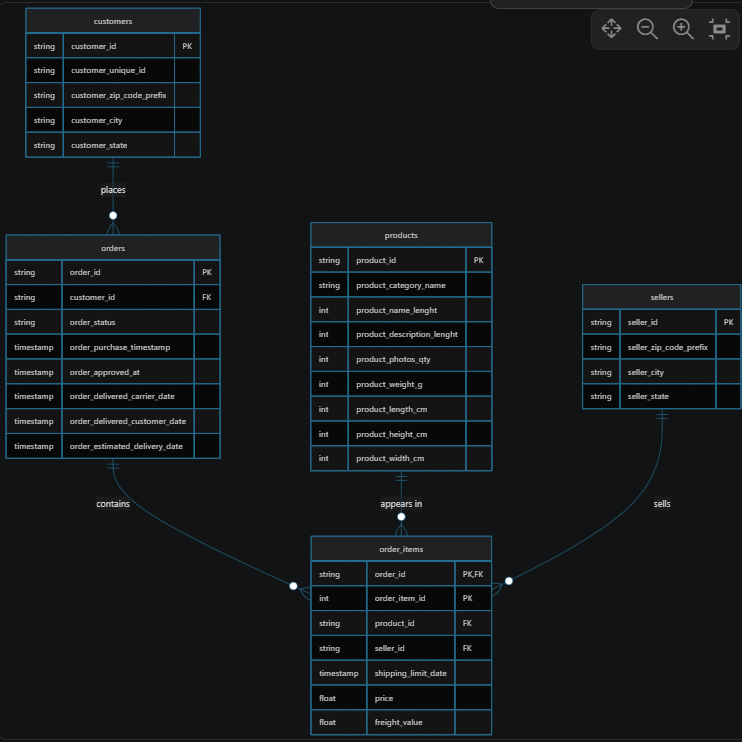

# KDDM Lab

A small data engineering and analytics lab for exploring the Olist Brazilian e-commerce dataset with DuckDB, pandas, and Jupyter.

This project loads raw CSV files into a DuckDB warehouse, validates relational integrity, and provides a foundation for analytical queries and data-quality checks.

## Overview

The repository focuses on the core Olist tables:

- customers
- orders
- order_items
- products
- sellers

These tables model customer transactions, item-level order details, product catalog information, and seller metadata. The project is designed to help with schema review, database validation, and reporting readiness.

## Project structure

```text
kddm_lab/
├── data/
│   ├── raw/
│   │   ├── olist_customers_dataset.csv
│   │   ├── olist_orders_dataset.csv
│   │   ├── olist_order_items_dataset.csv
│   │   ├── olist_products_dataset.csv
│   │   └── olist_sellers_dataset.csv
│   └── warehouse/
│       └── ecommerce.duckdb
├── src/
│   └── kddm_lab/
├── exercise.ipynb
├── SHORT_NOTE.md
├── pyproject.toml
├── uv.lock
├── README.md
└── .python-version
```

## Data model highlights

The main relational pattern is:

- one customer can place many orders
- one order can contain many order items
- each order item references a product and a seller
- the product and seller dimensions provide additional catalog and fulfillment context

This structure makes the data suitable for order-level analytics, product performance analysis, and seller performance reporting.

### Entity relationship diagram



The schema shows the core relationship flow:

- `customers` -> `orders` via `customer_id`
- `orders` -> `order_items` via `order_id`
- `products` -> `order_items` via `product_id`
- `sellers` -> `order_items` via `seller_id`

This is the central model used for validating referential integrity and building downstream analytical views.

## Data quality focus

The workflow checks for:

- primary key uniqueness
- referential integrity between parent and child tables
- null and missing timestamp values in order lifecycle data
- numeric range validation for price, freight, and product dimensions

A summary of the DB review is included in [SHORT_NOTE.md](SHORT_NOTE.md).

## Setup

This project uses Python and the `uv` package manager.

1. Install dependencies:

```bash
uv sync
```

2. Activate the environment:

```bash
source .venv/bin/activate
```

On Windows PowerShell:

```powershell
.\.venv\Scripts\Activate.ps1
```

3. Start Jupyter Lab:

```bash
jupyter lab
```

## Quick start

Open [exercise.ipynb](exercise.ipynb) to load the raw CSV files, create the DuckDB schema, and run the validation queries.

Example workflow:

```python
from pathlib import Path
import duckdb

root = Path.cwd()
raw_dir = root / "data" / "raw"
warehouse_dir = root / "data" / "warehouse"

con = duckdb.connect(str(warehouse_dir / "ecommerce.duckdb"))

print(con.sql("SELECT COUNT(*) FROM raw.orders").fetchone())
```

## Usage ideas

This repository is appropriate for:

- SQL and DuckDB practice
- data quality checks and warehouse loading
- analytics on e-commerce order data
- learning about star schema and relational integrity

## Notes

- Raw files are kept under `data/raw/`.
- Loaded warehouse data sits in `data/warehouse/`.
- The project is intentionally lightweight and easy to extend with additional transformations, data quality rules, or dashboarding.

## License

This project is intended for educational and experimental use.
